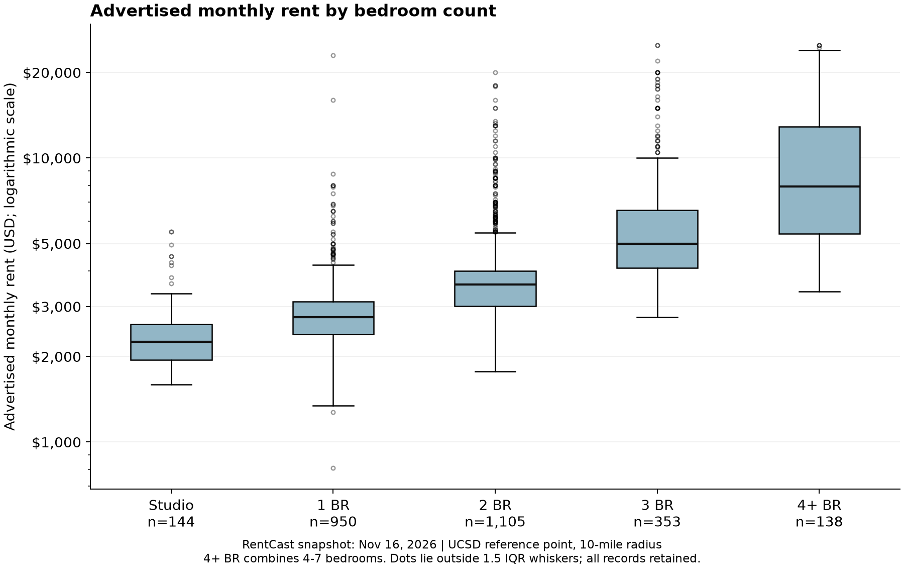
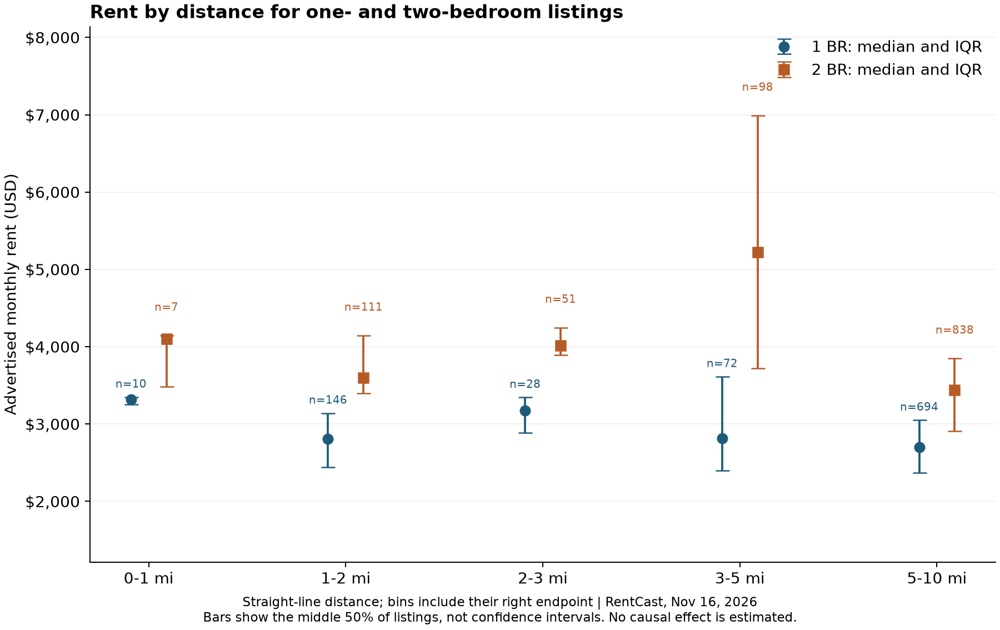

# Member A: data preparation and initial analysis

Prepared November 16, 2026. This is a contribution package for the team, **not the complete M2 submission**. The final submission still needs Member B's requirements and diagrams, Member C's functional tests and report integration, and student-written reflection. The final spec has a four-page limit unless extra length is justified; condense these materials before merging them into that spec.

## What is implemented

- Read the frozen SQLite snapshot without write access; verify file checksums and database integrity.
- Preserve all original listing IDs and fields, add numeric analysis columns, calculate straight-line distance and advertised price per square foot, and add review/eligibility flags.
- Write a separate derived SQLite database and JSON export. No new API calls are made.
- Produce grouped price summaries and two figures with sample sizes and explicit units.
- Run three unit tests with hand-calculated fixtures. See `results/member_a/unit_tests.txt` for the recorded run and `tests/test_member_a.py` for the executable cases.

## Report-ready: Data Models

Our dataset contains 2,690 unique rental listing IDs returned by RentCast for a 10-mile straight-line radius around the UCSD reference coordinate (32.8801, -117.2340), filtered to provider status Active. Data were collected on November 16, 2026, from 10:21:39 to 10:23:19 Pacific time. Each row represents one provider advertisement; we have not independently verified whether every advertisement describes an entire unit, a room, or a floorplan. The principal analysis variables are advertised monthly rent, bedrooms, bathrooms, floor area, property type, geographic coordinates, and distance from the reference point. Floor area is missing for 85 records; the remaining 2,605 support price-per-square-foot calculations.

The frozen SQLite database contains `listings` (2,690 rows, 20 columns, listing ID primary key), `raw_listings` (complete provider JSON linked by listing ID), and `snapshot_metadata` (collection and verification information). Original JSON responses, a schema, and SHA-256 checksums are stored alongside it. The analysis reads this database in read-only mode and writes `data/processed/member_a/analysis.sqlite`, with one `analysis_listings` row for each original ID and a unique index on ID. A parallel JSON export supports other project components. Summary tables, plots, execution metadata, and test evidence are separate files under `results/member_a/`; the frozen data are never overwritten.

The full field dictionary is in [data_dictionary.md](data_dictionary.md). Compact schema for the report:

| Fields | Meaning / type |
| --- | --- |
| `id` | Unique provider listing identifier; text |
| `formattedAddress`, `city`, `state`, `zipCode` | Location labels; text, postal codes retained as text |
| `latitude`, `longitude` | Geographic coordinates; decimal degrees |
| `propertyType`, `bedrooms`, `bathrooms` | Provider category and numeric room counts; zero bedrooms means studio |
| `price`, `squareFootage` | Advertised monthly USD and reported square feet; area can be null |
| `status`, `listedDate`, `lastSeenDate`, `daysOnMarket` | Provider status, date strings and market duration in days |
| `sourcePageOffset`, `sourceRequestedAtUtc` | API page provenance and collection timestamp |
| `distanceToCampusMiles`, `advertisedRentPerSqft` | Frozen derived distance and USD/sqft/month |
| Analysis columns | Typed aliases, recomputed distance/unit price, group labels, eligibility and review flags; see dictionary |

## Report-ready: Assumptions & Constraints

We treat `price` as advertised monthly USD and `squareFootage` as reported area in square feet, following the provider's field meanings. We use a single frozen provider snapshot, so findings describe this query result rather than all UCSD-area housing or market trends over time. Provider Active status and last-seen timestamps do not independently confirm current availability. Advertisements may differ in room-versus-unit basis, fees, concessions, furniture and lease duration. Distance is straight-line distance to a fixed campus point, not travel time. Shared coordinates may represent multiple units or floorplans and are not grounds for deletion. Missing area is not imputed: those records remain in monthly-rent analyses but are excluded from area-based metrics. Unusual values are retained with review flags; descriptive comparisons do not establish that location causes price differences.

## Processing rules and review decisions

1. Verify every frozen checksum and SQLite integrity. Reject missing or duplicate IDs rather than silently deleting rows. Preserve original provider values and use separate numeric columns for analysis.
2. Monthly-rent eligibility requires finite positive rent, valid coordinates within 10 miles, and provider status Active. All 2,690 frozen records qualify. Area-based eligibility additionally requires finite positive area: 2,605 qualify. Do not fill missing area with zero or a median.
3. Compute USD/sqft/month as price divided by area. Invalid price or area returns a missing result. Recompute Haversine distance with an Earth radius of 3,958.7613 miles. Distance bins are [0,1], (1,2], (2,3], (3,5], and (5,10] miles.
4. Mark review cases without automatic deletion: price outside bedroom-specific 1.5 IQR fences when the bedroom group has at least four records; area below 250 or above 5,000 sqft; room-related address wording; Multi-Family property type; and more than 365 days on market. These are transparent heuristics, not verified errors. Unflagged rows are not guaranteed to be whole-unit or error-free records.
5. Retain shared coordinates and unit identifiers. Coordinate-based deduplication would incorrectly remove distinct advertisements. A supplementary median of per-coordinate medians is reported as a sensitivity check; coordinates are not verified buildings.
6. Summarize using n, median, mean, quartiles, minimum and maximum. Quartiles use linear interpolation. `n_records` is group size, `n_valid` is the statistical denominator, and `n_missing` counts missing or invalid amounts excluded from that metric. The main boxplot groups 4-7 bedrooms as 4+ BR; detailed tables retain each bedroom count.

## Initial results and interpretation

- All 2,690 IDs were retained. Missing rent, invalid coordinates and duplicate IDs: zero. Missing area: 85 (3.16%).
- Median advertised monthly rent: **$3,295**; range **$810-$25,000**. This is a listing-level descriptive statistic, not an estimate of an individual student's housing budget.
- The snapshot contains 1,906 Apartments, 350 Single Family listings, 336 Condos, 92 Townhouses and 6 Multi-Family listings.
- Two addresses contain room-related wording. Twelve areas fall below 250 or above 5,000 sqft. These deserve review, but their true meaning cannot be determined from the fields alone.
- There are 1,326 distinct coordinate pairs; 1,573 records share coordinates with another listing, and the largest coordinate group contains 63 records. This limits an assumption of independent observations.
- Six-bedroom and seven-bedroom groups have only two and one records respectively. Interpret their detailed summaries cautiously; the main plot pools them with four- and five-bedroom listings.
- The distance figure compares 1BR and 2BR listings separately, reducing one source of mix differences. Property types, building quality, listing basis and other factors still differ; the figure does not estimate a causal or adjusted distance effect. Near-campus subgroups can be small.

See the machine-generated [summary](../results/member_a/summary.json), [bedroom summaries](../results/member_a/rent_by_bedrooms.json), and figures below. These results are provisional descriptive evidence, not completed project conclusions.

## Three unit test cases for the rubric

All fixtures are synthetic and independent of the frozen sample. Preconditions for every case: the analysis dependencies are installed, the helper module imports successfully, and no API or database access is required. Actual results recorded on November 16, 2026: all three passed.

| ID / function | Inputs and steps | Expected result / postcondition | Actual |
| --- | --- | --- | --- |
| UT-A1: `unit_rent` normal calculation | Call `unit_rent(3000, 1000)` | Return 3.0 USD/sqft/month within numerical tolerance; no exception | PASS |
| UT-A2: `unit_rent` invalid area | Call `unit_rent(3000, area)` for None, 0, -100, NaN, +infinity and -infinity | Return None for each input; no divide-by-zero or nonfinite result | PASS, all six subcases |
| UT-A3: `group_summary` | Construct Studio rents [1000, 3000, None] and 1BR rents [1800, 2200, 8000, None]; group by bedroom label | Studio: n_records=3, n_valid=2, n_missing=1, median=2000. 1BR: 4, 3, 1, median=2200. Exactly two output groups; missing values are excluded rather than treated as zero | PASS |

Run: `PYTHONPATH=src python -m unittest tests.test_member_a -v`.

These are the three selected **unit** cases. End-to-end execution and snapshot checks provide additional verification but do not replace the three **functional** test cases required for the whole team.

## Progress evidence and team handoff

| Rubric module / owner | A's contribution and evidence | Remaining work |
| --- | --- | --- |
| Data Models / A | Data description, full dictionary, frozen and derived storage design | Team review and condense for final spec |
| Assumptions & Constraints / A | Above paragraph and explicit missingness/outlier rules | Confirm agreed project scope |
| Unit Test Cases / A | UT-A1-UT-A3 implemented and passing | C incorporates cases in final report |
| Code Submission / A contributes | Offline pipeline, reusable helpers, actual generated tables/plots | B adds agreed filter functionality; team tests integration |
| Progress Check against Spec / team | A's preparation and initial analysis implemented; no rows dropped; test evidence recorded | B assigns final requirement IDs; C maps implementation/tests to those IDs and reports remaining work |
| Requirements and diagrams / B | Existing interfaces and data model available for B to use | B writes requirements, three UML types and explanations; diagrams must match actual code |
| Functional tests and report / C | A provides data and unit-test evidence | C documents/runs three functional tests against the team's chosen requirements and integrates the PDF |
| Reflection / students | No reflection text generated | Students write 1-2 paragraphs in their own words |

### Member B: integration interface

Run `python scripts/run_member_a.py` once. Read `data/processed/member_a/analysis.sqlite`, table `analysis_listings`, or its JSON equivalent. Useful columns: `id`, `monthly_rent_usd`, `bedroom_count`, `bathroom_count`, `area_sqft`, `propertyType`, `zipCode`, `distance_miles`, `rent_per_sqft_usd`, and the two eligibility flags. SQLite booleans are stored as 0/1. Filter `eligible_for_rent_analysis = 1` for rent summaries and `eligible_for_area_analysis = 1` for area-based summaries. Preserve listing IDs when selecting rows; show the relevant sample size and handle empty selections. Existing `group_summary` accepts a DataFrame, grouping column and optional value column. No UI/filter component is implemented in A's module.

### Member C: report integration

Use the two report-ready sections, compact schema and three test cases above. Select at most the figures needed to make progress clear; do not paste this whole handoff into the four-page spec. Use `results/member_a/run_manifest.json`, `unit_tests.txt`, and `integration_checks.json` as evidence. Do not mark all final project requirements as met based only on this pipeline. The final M2 submission is one PDF plus a code ZIP or accessible GitHub link, due Monday November 23 per the rubric; verify Gradescope's displayed time when submitting.

### Member A: review before claiming ownership

Read the helper functions and run the commands in the README. Be able to explain the 85-row area limitation, why unusual listings remain, what the two plots show, and why the distance comparison is not causal. Review the results with the team and write the required reflection personally. AI assistance with code, tests, figures and documentation is disclosed in the repository README.

## Sources within this project

- Frozen dataset manifest, schema and original records: `data/frozen/ucsd_rentals_2026-11-16_102139_PT/`.
- Executed pipeline and fixtures: `scripts/run_member_a.py`, `src/ucsd_rentals/data.py`, `tests/test_member_a.py`.
- Course requirements: instructor-provided `Project_update_rubric_dsc200_fa26.pdf` (Project Update due Monday 11/23). This package does not reproduce a student reflection.
